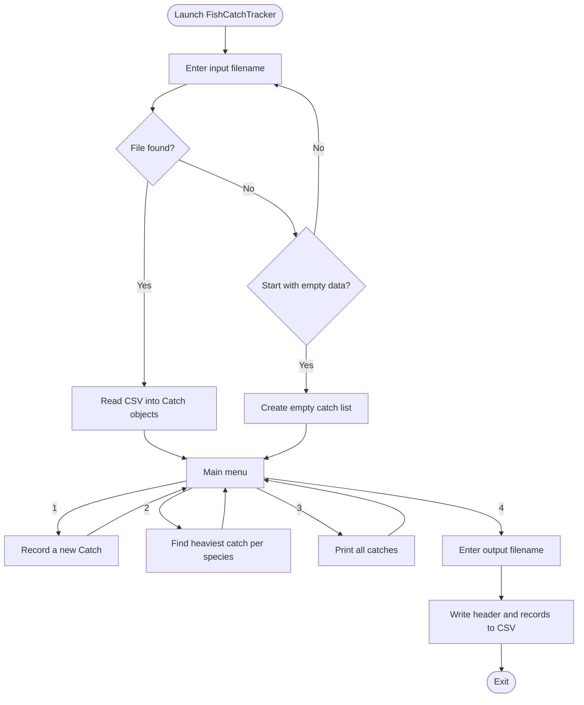

<div align="center">

# 🎣 Fish Catch Tracker

**A Java console application for recording catches, reviewing fishing logs, and finding species records.**


</div>

---

## 📌 Overview

**Fish Catch Tracker** is a menu-driven Java application that manages fishing catch records through a command-line interface. It loads catch data from a user-selected CSV file (or starts with an empty collection), stores records as `Catch` objects, and writes the collection to a CSV file when the user chooses **Save and Quit**.

Each record includes an angler's license, fish species, weight, length, and catch date. The application can also identify the heaviest recorded catch for each species, using the earlier catch date to break weight ties.

## ✨ Features

| | Feature | Implementation |
| :---: | :--- | :--- |
| 🎣 | **Record a new catch** | Collect license, species, weight, length, year, month, and day. |
| 🏆 | **Determine fish records** | Display the heaviest catch for each species; select the earlier date when weights tie. |
| 📋 | **View all catches** | Print every stored catch using the `Catch.toString()` format. |
| 📂 | **Load existing data** | Read a named CSV file, or retry / start empty if the file is not found. |
| 💾 | **Save and quit** | Prompt for an output filename, write the CSV header and all current records, then exit. |
| 🛡️ | **Check numeric formats** | Reprompt when **weight** is not a `float` or **length** is not an `int`. |

## 🖥️ Console Preview

Example interaction using the application's actual prompts and output formats. The sample values below are illustrative; lines without prompts represent user input.

```text
What is the name of the data file?
CatchData.csv
File not found. Start new file? (Y/N)
Y
What would you like to do?
1 = Record New Catch
2 = Determine Fish Records
3 = Print All Data to Screen
4 = Save and Quit
1
Which angler caught the fish? Enter their license.
L112233
What was the fish species?
Bass
What was the weight?
2.89
What was the length?
18
What was the year?
2025
What was the month (number)?
1
What was the day (number)?
1
What would you like to do?
1 = Record New Catch
2 = Determine Fish Records
3 = Print All Data to Screen
4 = Save and Quit
3
Angler L112233 caught a Bass: 2.89lbs, 18inches, on 2025/1/1
What would you like to do?
1 = Record New Catch
2 = Determine Fish Records
3 = Print All Data to Screen
4 = Save and Quit
2
Biggest bass had weight 2.89 and length 18 and was caught by L112233 on 2025/1/1
What would you like to do?
1 = Record New Catch
2 = Determine Fish Records
3 = Print All Data to Screen
4 = Save and Quit
4
Enter the file name to store data.
CatchData.csv
```

## 🔄 Application Workflow



## 🗂️ Project Structure

```text
fish-catch-tracker/
├── FishCatchTracker.java   # Main method, menu, CSV I/O, and record comparison
├── Catch.java              # Catch data model, constructors, getters, setters, toString()
└── README.md               # Project documentation
```

> CSV files are selected by filename at runtime. You do not need a preexisting data file to start using the program; a new one is written when you save. File paths are resolved relative to the application's working directory unless you enter a path.

## 🚀 Getting Started

### Option 1 — Eclipse

1. Open or import the project in **Eclipse**.
2. Ensure both `FishCatchTracker.java` and `Catch.java` are present in the source folder and use the same package.
3. Right-click **`FishCatchTracker.java`** → **Run As** → **Java Application**.
4. Enter the name of an existing CSV file, or choose `Y` if it is not found and you want to start with an empty collection.
5. Use the menu to add catches, view records, or save the data.

### Option 2 — Terminal

From the directory containing the two `.java` files, with a JDK installed:

```bash
javac Catch.java FishCatchTracker.java
java FishCatchTracker
```

> These commands assume neither Java file declares a `package`. For a named Java package, use its corresponding directory and fully qualified main class.

## 🧾 CSV File Format

The application writes the following **exact header and column order**:

```csv
License,Species,Weight,Length,Year,Month,Day
L112233,Bass,2.89,18,2025,1,1
L445566,Bass,100.0,200,2025,2,2
L111111,Snapper,90.0,99,2024,11,11
```

| Column | Java data type in `Catch` | Example |
| :--- | :--- | :--- |
| `License` | `String` | `L112233` |
| `Species` (`name`) | `String` | `Bass` |
| `Weight` | `float` | `2.89` |
| `Length` | `int` | `18` |
| `Year` | `int` | `2025` |
| `Month` | `int` | `1` |
| `Day` | `int` | `1` |

The first CSV row is treated as the header and skipped when reading. Subsequent rows are split on commas and converted into `Catch` objects stored in an `ArrayList<Catch>`.

## 🏆 How Fish Records Are Selected

For each fish species, the program keeps **one winning catch**:

1. Compare weight and select the **heavier** catch.
2. If weights are equal, compare **year → month → day**, selecting the **earlier** catch.
3. Match species names **without case sensitivity** (for example, `Bass` and `bass` are treated as the same species).

**Example:**

| Species | Weight (lbs) | Date | Result |
| :--- | ---: | :--- | :--- |
| Bass | 5.0 | 2025/6/10 | — |
| bass | 5.0 | 2024/8/20 | 🏆 Record: earlier date |
| Bass | 3.5 | 2023/1/5 | — |
| Snapper | 8.2 | 2025/7/2 | 🏆 Record: only Snapper entry |

## 🧩 Code Organization

| Java class | Responsibility |
| :--- | :--- |
| **`FishCatchTracker`** | Runs the menu; reads CSV data; collects user input; compares catches; prints records; saves CSV output. |
| **`Catch`** | Encapsulates one record with seven fields, a default and parameterized constructor, getters/setters, and a `toString()` method. |

Key methods in `FishCatchTracker` include `dataFile()`, `printMenu()`, `recordNewCatch()`, `heaviest()`, `printAllData()`, and `printToFile()`.

## ⚠️ Current Input & File Handling

The program handles invalid **weight** and **length** formats by catching `InputMismatchException` and asking again. Some other cases are **not yet validated**:

- Menu selection and catch-date fields are read using `nextInt()` without equivalent retry handling.
- Date ranges, nonnegative measurements, and blank or multiword species names are not checked. License and species inputs use `Scanner.next()`, which reads one whitespace-delimited token.
- CSV parsing expects rows in the specified seven-column format; malformed rows or invalid numeric values can cause errors. Fields containing embedded commas are not supported.
- Saving with `PrintWriter` can overwrite an existing file with the same name. If opening the output file fails, the program prints `File not found.` and still exits the menu.

These are potential improvements rather than features of the current implementation.

---

<div align="center">

**Built with Java • Object-Oriented Programming • Collections • File I/O**

</div>
